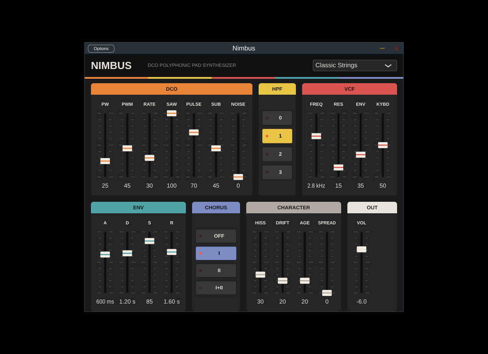

# NIMBUS

A vintage DCO polysynth for pads, inspired by the classic early-80s single-oscillator
polysynths: saw + PWM pulse + sub + noise, the 4-position high-pass, a 4-pole ladder
filter, and a two-line bucket-brigade stereo chorus with its hiss. Plus drift and an
**AGE** control for saturation, mains hum and a duller top end.

It ships in two forms that share one DSP core (`Source/nimbus_dsp.h`):

| | Where | Formats |
|---|---|---|
| **Desktop plugin** | `Source/` | VST3 + AU + Standalone (macOS), VST3 + Standalone (Linux/Windows) |
| **Hardware oscillator** | `microkorg2/` | logue SDK `.mk2unit` for the KORG microKORG2 (firmware 2.0+) |



## Getting the Mac plugin
Every push to `main` builds a universal (Apple Silicon + Intel) Mac version on GitHub
Actions. Open the **Actions** tab, click the latest run and download **Nimbus-macOS**
under *Artifacts*. Then follow `INSTALL.txt`.

Push a tag like `v1.0.0` to attach the zip to a GitHub Release.

## Building locally
```
cmake -B build -DCMAKE_BUILD_TYPE=Release
cmake --build build --config Release
```
JUCE 8 is fetched automatically. On a Mac with Xcode, add `-G Xcode`.

## Desktop controls
- **DCO:** PW, PWM depth/rate, SAW, PULSE, SUB, NOISE
- **HPF:** 0 (bass boost), 1 (flat), 2, 3
- **VCF:** FREQ, RES, ENV amount, KYBD tracking
- **ENV:** ADSR (drives both the VCF and the VCA)
- **CHORUS:** OFF / I / II / I+II. Stereo: two delay lines swept in opposite phase
- **CHARACTER:** HISS (always there, louder with the chorus on), DRIFT, AGE, SPREAD (voice panning)
- **OUT:** volume

Eight voices with oldest-note stealing, sustain pedal and ±2 semitone pitch bend.

Factory presets: Classic Strings, Shimmer Pad, Warm Brass Pad, Hollow PWM,
Worn Voice Card, Night Drive, Plain DCO.

## Notes
- JUCE is dual-licensed (AGPLv3 / commercial). Personal use is fine. Check JUCE's
  licence terms before selling the plugin.
- "Juno" is a Roland trademark. Keep it out of the product name.
